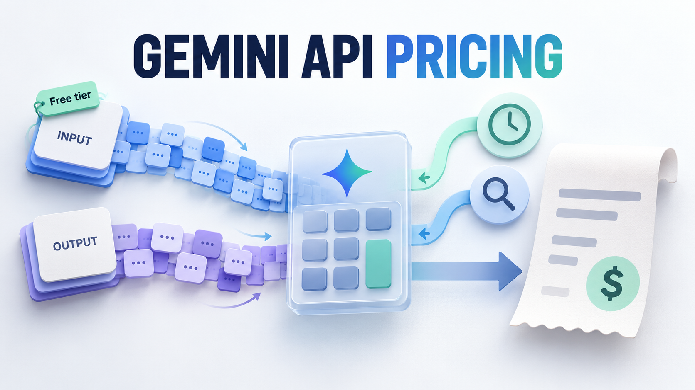
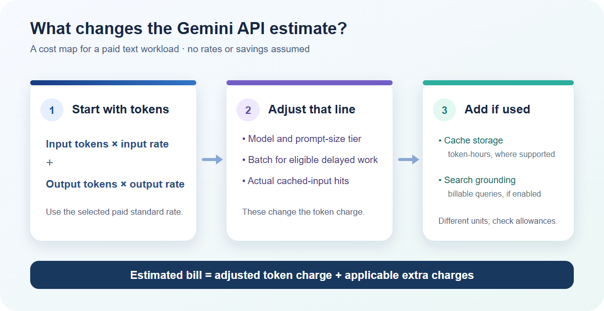

# Gemini API Pricing in 2026: Model Rates, Free Tiers, and Costs Beyond Tokens

*Cover: the token inputs and optional cost paths that shape a Gemini Developer API bill.*

Gemini API pricing depends on **which Developer API model you call, how many input and output tokens it processes, and which paid features you use**. For a text-heavy application, start with the standard per-million-token rates below. Then check whether your workload crosses a long-prompt threshold, qualifies for caching or Batch, or uses Search grounding. Those conditions can change the bill more than a small difference between headline model prices.

This article covers Google's **Gemini Developer API**, using Google's published prices checked on October 27, 2026. It does not price consumer Gemini subscriptions, Vertex AI contracts, image generation, taxes or any intermediary's own charges. The example is hypothetical; no account or model was tested.

## The model rates worth comparing first

For a paid **standard text** request, Google's [official Developer API pricing page](https://ai.google.dev/gemini-api/docs/pricing) lists these representative rates in USD per 1 million tokens. Output rates include thinking tokens where the model uses them. This is a shortlist for app budgeting, not a complete catalog of Gemini modalities and service modes.

| Model | Paid input / 1M | Paid output / 1M | Developer API free tier? | Price condition |
| --- | ---: | ---: | --- | --- |
| Gemini 2.5 Flash-Lite | $0.10 | $0.40 | Yes | Standard text; audio input costs more |
| Gemini 3.5 Flash-Lite | $0.30 | $2.50 | Yes | Standard text; output includes thinking tokens |
| Gemini 3.8 Flash | $0.75 | $3.75 | Yes | Rates shown apply through December 31, 2026 |
| Gemini 3.1 Pro Preview | $2.00 | $12.00 | No | Prompts of 200,000 tokens or fewer; above that, $4.00 input and $18.00 output |

Google lists Gemini 3.8 Flash at **$1.50 input and $7.50 output** per million from January 1, 2027. A forecast extending into 2027 should use that later schedule for relevant usage, not multiply all future tokens by today's rate. Pro Preview's 200,000-token boundary concerns the size of a *prompt*, not monthly token volume. If your application sends long contexts, segment the estimate by request size.

## What the free tier actually buys you

“Free tier” is not a flat monthly dollar credit and does not make every Gemini model free. The models marked Yes above have free input and output in their listed standard tiers, while Gemini 3.1 Pro Preview is unavailable on the free tier. Google says new accounts begin on the free tier with access to **certain models**; each model's [rate limits](https://ai.google.dev/gemini-api/docs/rate-limits) still apply. Those limits are evaluated per project and vary by model, so a zero-token-price prototype may still be unable to handle production traffic. Test rate limits before choosing the free tier for a launch.

The data-use distinction may matter as much as the price. Google's rate card says free-tier content is used to improve its products, while paid-tier content is not under the terms linked there. If your application handles sensitive material, review the current terms rather than treating the free column as the whole decision. Google's [billing guide](https://ai.google.dev/gemini-api/docs/billing) says moving to a paid tier involves linking an active billing account and prepaying at least $5 or the local equivalent; higher usage tiers depend on payment history. That is an account setup condition, not an extra per-token rate.

Use free access for an eligible, low-volume evaluation when its rate and data-use conditions fit. Budget paid access when your model is paid-only, your required throughput exceeds the free limits, or the paid data-use terms are necessary. Check your own active limits before committing to a launch.

## Turn a workload into a monthly estimate

The base paid-token formula is simple: **(input tokens ÷ 1,000,000 × input rate) + (output tokens ÷ 1,000,000 × output rate)**. Count both sides. An output-heavy application can reverse the intuition you get from input prices alone.

Suppose a month uses **10 million text input tokens and 2 million output tokens**, all on paid standard requests, with no cached hits, Batch, grounding, long-prompt surcharge or other modalities. At the prices above, the model-only estimate is:

| Model | Input calculation | Output calculation | Model-only total |
| --- | ---: | ---: | ---: |
| Gemini 2.5 Flash-Lite | 10 × $0.10 = $1.00 | 2 × $0.40 = $0.80 | **$1.80** |
| Gemini 3.5 Flash-Lite | 10 × $0.30 = $3.00 | 2 × $2.50 = $5.00 | **$8.00** |
| Gemini 3.8 Flash | 10 × $0.75 = $7.50 | 2 × $3.75 = $7.50 | **$15.00** |
| Gemini 3.1 Pro Preview | 10 × $2.00 = $20.00 | 2 × $12.00 = $24.00 | **$44.00** |

These totals say nothing about answer quality or latency. They also assume every Pro prompt stays at or below 200,000 tokens. For your own budget, replace the invented volumes with actual input, output and cached-token counts. Google's [token and usage guide](https://ai.google.dev/gemini-api/docs/tokens) identifies preflight counting and response usage fields, including output, thought and cached tokens. We did not call that API for this article. If output rises from 2 million to 5 million tokens while input stays fixed, the 3.8 Flash estimate becomes **$26.25**, showing why output mix deserves its own forecast.

## Costs and price switches beyond the base token line

The worked estimate is a baseline. Add or change only the terms that your chosen model, endpoint and workflow actually use:

*Bill map: modifiers change the token line; supported storage and billable grounding add separate units.*

- **Caching can lower repeated-input charges, but a hit is not guaranteed.** Google's [caching guide](https://ai.google.dev/gemini-api/docs/caching) says implicit caching is enabled for Gemini 2.5 and newer models and sets model-specific minimum token counts; it also points to cached-token usage in responses. The rate card lists a separate cached-input rate and, where explicit caching is supported, a **token-hour storage price**. For 3.8 Flash through December 2026, the published cache-hit input rate is $0.075 per million and the listed storage price is $0.50 per million tokens per hour. Do not subtract a guessed cache discount from every request or ignore storage duration. Explicit caching also depends on model and API support.
- **Search grounding can add a different billing unit.** For Gemini 3 and newer models on the [official rate card](https://ai.google.dev/gemini-api/docs/pricing), the paid tier includes 5,000 Search requests per month shared across those models, then lists **$14 per 1,000 requests**. Google's footnote says one customer request may trigger multiple Search queries and each query can be charged. If you enable grounding, record the actual billable Search queries separately from tokens; a prompt count is not automatically a search-query count.
- **Batch changes both price and timing.** Google's [Batch API guide](https://ai.google.dev/gemini-api/docs/batch-api) describes asynchronous processing at 50% of standard cost with a 24-hour target turnaround, intended for non-urgent work. For the hypothetical 3.8 Flash workload above, moving *all eligible calls* to its published Batch input and output rates would reduce the model-token line from $15.00 to **$7.50** through December 2026. That is not a choice for a request that needs an immediate answer, and it does not erase other applicable charges.
- **Long prompts and dated prices can lift a quote.** Gemini 3.1 Pro Preview doubles its input rate from $2 to $4 per million when a prompt exceeds 200,000 tokens, and output rises from $12 to $18. The 3.8 Flash schedule also changes on January 1, 2027. Recalculate by prompt-size and date buckets instead of averaging away a threshold.

Keep these billing units separate: input tokens, output tokens, cached tokens, cache token-hours and grounding requests. A rate table cannot tell you your cache hit ratio, tool use or output length; only a representative workload can.

## Choose a model and access path on your own measurements

For a low-stakes, high-volume text task, a Flash-Lite option is a sensible cost baseline to evaluate. Move to 3.8 Flash or Pro Preview only when your own task tests show enough value to justify the higher output rate, the preview status and any long-context exposure. Price alone cannot establish reliability, quality or latency. If free-tier throughput or data-use terms do not fit, use paid-tier assumptions from the start; if work can wait, test Batch as a separate workflow.

The prices above are **direct Google Developer API prices**. Moduck, the publisher of this article, is an AI API aggregator for developers and product teams. Its documented goal is to make model API access easier to manage, but we have not verified a current Moduck Gemini listing, model-specific price, account eligibility or callability. A unified route may be useful if you need to compare several model providers; direct Google remains a valid choice when its terms and integration meet your requirements. Compare the actual quoted rates, supported models, billing rules and operational fit before selecting a route.

If a unified API could fit your stack, confirm the listed Gemini model, your account terms and the platform's own pricing before comparing it with direct Google access. [Read the documentation](https://docs.moduck.ai/). Check current documentation before signing in or requesting a key.

